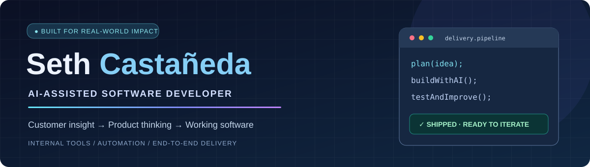
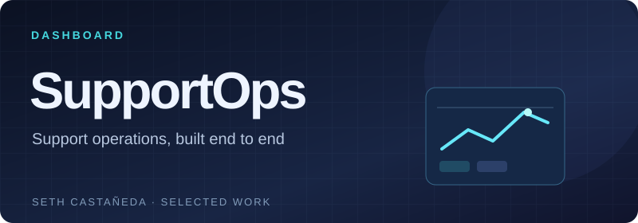
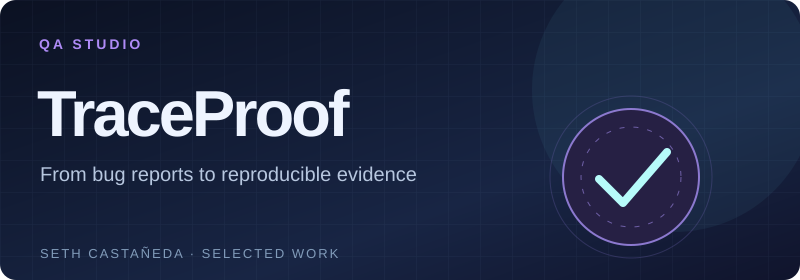

<div align="center">
  
  <br /><br />
  <a href="https://github.com/Name-less56?tab=repositories"></a>
  <a href="https://www.linkedin.com/in/seth-castro/"></a>
  <br /><br />
  <strong>AI-Assisted Software Developer · Full-Stack Product Builder</strong>
  <br />
  <sub>From customer insight to working software. Based in Bogotá, Colombia.</sub>
</div>

<br />

## Hi, I'm Seth

I build software around real problems. My background in **Customer Service** taught me how people actually experience products; my work in **AI-assisted development** lets me turn those insights into useful applications.

I've contributed to **end-to-end internal application delivery at Eneba**, covering requirements, UX/UI decisions, AI-assisted implementation, testing, deployment, and iteration. I also build public projects to explore full-stack engineering, automation, developer tooling, and product design.

> My approach: **understand the problem → design a usable solution → build with AI assistance → test, debug, and improve.**

## Featured projects

<table>
  <tr>
    <td width="50%" valign="top">
      <a href="https://github.com/Name-less56/supportops-dashboard"></a>
      <h3>SupportOps Dashboard <sub>v3.0</sub></h3>
      <p>Full-stack support operations workspace with role-based access, PostgreSQL-backed ticket workflows, SLA analytics, Kanban, administration, and reporting.</p>
      <p>   </p>
      <a href="https://github.com/Name-less56/supportops-dashboard"><strong>Explore code &amp; docs →</strong></a>
    </td>
    <td width="50%" valign="top">
      <a href="https://github.com/Name-less56/traceproof-qa"></a>
      <h3>TraceProof <sub>v2.2</sub></h3>
      <p>QA reproduction studio for structured bug cases, replay evidence, Playwright test generation, and isolated Chromium runs with trace artifacts in a supported local setup.</p>
      <p>   </p>
      <a href="https://github.com/Name-less56/traceproof-qa"><strong>Explore code &amp; docs →</strong></a>
    </td>
  </tr>
</table>

<details>
  <summary><b>See TraceProof in action</b></summary>
  <br />
  
</details>

## Professional work · Eneba

My professional development work includes an **internal application delivered with an AI-assisted workflow**. Its source code and implementation details remain private.

I document my role in requirements, application design, testing, delivery, and iteration in a public, confidentiality-conscious case study:

**[Internal Application Development · Case Study →](https://github.com/Name-less56/eneba-internal-application-case-study)**

## Toolbox

<div align="center">
  
</div>

<br />

| Focus | Tools and practices |
|---|---|
| **Software development** | JavaScript, TypeScript, Python, Node.js, SQL / PostgreSQL |
| **Development workflow** | Git, GitHub, Docker, debugging, automated testing, documentation |
| **AI-assisted development** | ChatGPT, OpenAI Codex, Claude, Claude Code |
| **Product delivery** | Problem discovery, requirements, UX/UI iteration, QA, deployment and maintenance |

<sub>This is my broader toolbox. Individual repositories use different subsets of these technologies.</sub>

## How I work

```text
Customer or product need
         ↓
Requirements + UX flow
         ↓
AI-assisted implementation
         ↓
Review, testing, debugging
         ↓
Working application + iteration
```

I use AI to accelerate implementation, while staying involved in defining behavior, reviewing results, investigating failures, and improving the final product.

## Currently exploring

More interactive, user-facing experiences alongside full-stack applications and developer tools. My public repositories are portfolio demonstrations that use **fictional or simulated data**, not real customer records.

<div align="center">
  <br />
  <b>Interested in AI-assisted software development, product engineering and tools that make people's work easier.</b>
  <br /><br />
  <a href="https://github.com/Name-less56?tab=repositories">GitHub projects</a> · <a href="https://www.linkedin.com/in/seth-castro/">LinkedIn</a>
</div>
